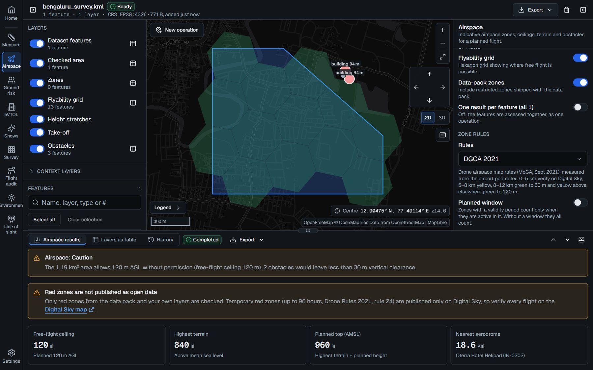
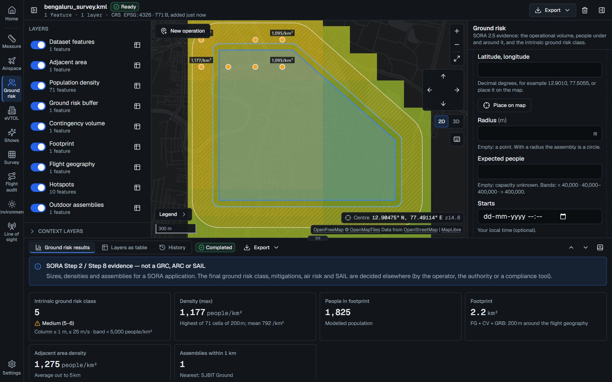
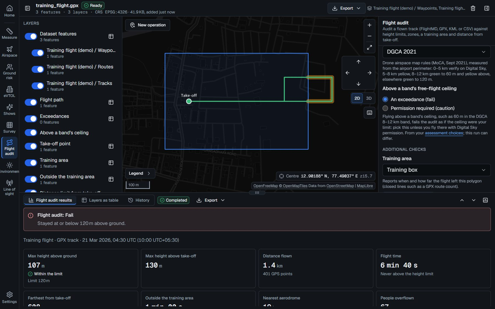
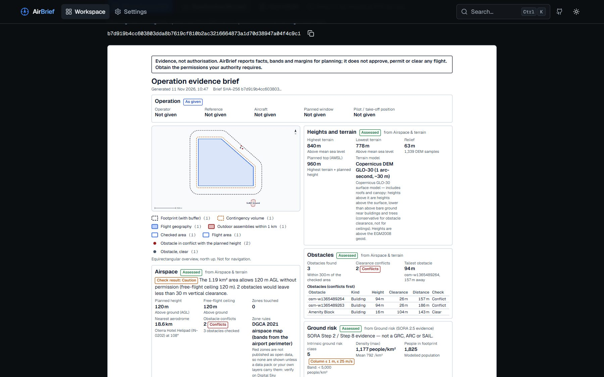

# AirBrief

Before a drone takes off, somebody has to answer a few unglamorous questions. Is this airspace
restricted? How high above the ground will it really fly? Who is underneath? Can the pilot keep
it in sight?

AirBrief answers them from a pin on a map, or from a file you already have (Shapefile, KML,
GeoJSON, GPX, CSV), and puts the answers on a one-page brief you can hand to a client, an insurer
or an authority. It runs on your own machine, works offline and needs no account or API key.

It never says go or no-go. It gathers the evidence; the pilot and the authority decide.



## What it checks

| | |
|---|---|
| **Measure** | Area, perimeter and length of every feature, in a projection centred on it |
| **Airspace** | Airport zones (India's DGCA 2021 rules by default), your own zone files (ED-269, ED-318), terrain and obstacles |
| **Ground risk** | The SORA 2.5 operational volume and how many people live under it |
| **Environment** | Daylight, the magnetic field, wind at height, nearby power lines |
| **Line of sight** | What the pilot can see, and whether the radio link clears the hills |
| **Survey and spraying** | Ground resolution, flight time, batteries, tank loads |
| **eVTOL** | Where a vertiport could go, and the corridor between two of them |
| **Drone shows** | Separation, geofence and audience distance, frame by frame |
| **Flight audit** | A flown track (GPX, KML, CSV or a FlightMD report) against the ground, the zones and the training area |

Most checks can also run once per feature: 200 farm plots give 200 rows and a CSV.

<p>
  
  
  
</p>

## Try it

You need Python 3.11+ and Node 20+.

```bash
python -m venv .venv && source .venv/bin/activate      # Windows: .venv\Scripts\Activate.ps1
pip install -e ".[api,dev]"
cp .env.example .env
python -m seed.datapack --synthetic --name demo        # offline demo data
uvicorn api.main:app --reload                          # API on :8000
cd frontend && npm install && npm run dev -- -H 127.0.0.1   # web app on :3000
```

Open http://localhost:3000 and load a sample, or start from a pin.

The demo data is made up. For a real area (up to 2° × 2°), build a pack from OpenStreetMap,
Copernicus DEM and WorldPop:

```bash
python -m seed.datapack --bbox 77.3,12.7,77.9,13.2 --name bengaluru --iso3 IND
```

## Works with FlightMD

[FlightMD](https://github.com/Praddyx15/FlightMD) reads the flight log after the flight. Paste a
brief's hash when you upload the log and the report remembers the plan; from any FlightMD report,
**Audit airspace in AirBrief** opens the same flight here. Set `FLIGHTMD_API_URL` so AirBrief can
fetch the report.

## More

- [`docs/SPEC.md`](docs/SPEC.md): the API (also live at http://localhost:8000/docs)
- [`docs/features/`](docs/features/): how each check works
- [`docs/rules/dgca.md`](docs/rules/dgca.md): where every DGCA number comes from
- [`testing/`](testing/README.md): running the tests
- [`DEPLOYMENT.md`](DEPLOYMENT.md), [`DOCKER.md`](DOCKER.md): hosting it
- [`SECURITY.md`](SECURITY.md): reporting a vulnerability

## Licence

MIT. The data comes from OpenStreetMap, OurAirports, Copernicus DEM, WorldPop and NOAA's World
Magnetic Model, each under its own licence ([`DATA_LICENSES.md`](DATA_LICENSES.md)).

Results are indicative. AirBrief is not an official airspace map or a safety assessment, and it
does not replace authorisation such as DGCA Digital Sky.
